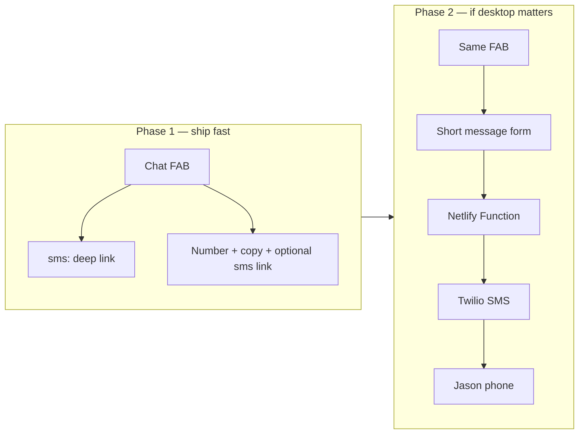

# SMS / “Let’s chat” feature — planning

Jason asked to keep a **contact / chat bubble** on the site, but to reach him on his **phone as a text** (or iMessage between iPhones), not as email like the current Wix widget. This doc compares ways to do that, what each costs, and a concrete code plan for this repo.

**Related docs**

- Client ask: `docs/email.md` (meeting notes)
- Zero-server bubble spec (task 5): `docs/first-tasks.md` § “Chat bubble that texts them”
- Demo scope (v1 had no bubble): `docs/first-scope.md`

**Recipient (today)**

- Jason mobile: **250-540-3511** → E.164 **`+12505403511`** (already in footer / contact copy)
- Marsha: optional second line later; not in v1 unless they ask

---

## What “success” looks like

| Actor | Experience |
| --- | --- |
| Visitor on **phone** | Tap bubble → draft message to Jason → send from their own Messages/SMS app |
| Visitor on **desktop** | Still able to reach Jason without email being the primary path |
| Jason | Incoming **text thread** on his phone; visitor’s number on the message when they send from their device |
| Us (builders) | Prefer **no email** as the main notification; email stays a separate contact-form path if we wire it later |

**Non-goals (unless Jason explicitly expands scope)**

- Full live chat with typing indicators and in-widget replies
- Storing conversation history in our database
- Replacing the contact page form in the first ship

---

## Hard constraint (why this is not one obvious button)

Browsers and static sites **cannot** inject a message into the cellular network by themselves. SMS/MMS delivery requires:

- The **visitor’s phone** sending via `sms:` / their carrier, or
- A **telephony provider** (Twilio, etc.) with API keys on a **server** we control

So every design is either **“open their text app”** (client-only) or **“our backend sends SMS”** (Twilio + serverless/API).

---

## Options overview

| Option | Jason gets | Desktop works? | In-app widget? | Monthly cost | Complexity |
| --- | --- | --- | --- | --- | --- |
| **A. `sms:` deep link bubble** | Text from visitor’s phone | Partial (copy number, Mac Messages if signed in) | Small panel, not a chat transcript | **$0** | Low |
| **B. Twilio outbound only** | SMS from a site number to Jason | Yes (form in widget → API → SMS) | Yes (mini form) | Twilio + number | Medium |
| **C. Twilio two-way (SMS ↔ widget)** | SMS; replies need threading UI | Yes | Yes (chat-like) | Higher usage + dev | High |
| **D. Email / form → SMS gateway** | SMS via email-to-SMS gateways | Yes | Form | Unreliable / carrier-specific | **Not recommended** |
| **E. Third-party chat (Intercom, etc.)** | Often email/push first | Yes | Yes | SaaS $ | Medium; may not be “text to Jason” |

**Preference from Jason:** text to his phone, **not** email-as-notification. That rules out Wix-style email alerts and makes **A** or **B/C** the serious candidates.

---

## For Jason — Twilio paths in plain language

Use this section when you walk Jason through **Option B (outbound only)** vs **Option C (two-way)**. Both use the same bubble on the Uplift site; the difference is what happens after he gets the text and whether the visitor sees replies on the website.

### Third-party services (what we’re actually paying for)

| Service | Role | Jason touches it? |
| --- | --- | --- |
| **Twilio** | Sends (and optionally receives) SMS over the phone network. We rent a **business phone number** from Twilio; that number is the “from” line on texts the site triggers. | Usually no — we set it up; he just reads texts on **his** phone (250-540-3511) unless we route differently. |
| **Netlify** (already hosting the site) | Runs a small **serverless function** — a few lines of backend that hold Twilio’s secret keys safely and call Twilio when someone submits the widget. | No. |
| **Our React site** | The chat bubble UI — button, short message box, styling to match Uplift. | No — visitors see this. |

We are **not** buying Text Request, Textmagic, GoHighLevel, or another “embed their widget” product. Those are all-in-one dashboards. Twilio is the **carrier pipe**; we build the bubble and own the experience.

Optional later: **Turnstile** (spam captcha) if bots abuse the form — not required on day one.

---

### Option B — Twilio outbound only (“site notifies Jason by text”)

**What Jason gets**

- A **text message on his cell** when someone uses the chat bubble on the website (same idea as the Wix bubble, but **SMS instead of email**).
- Each text is a **one-shot alert**: who said what, which page they were on, and optionally a phone number if the visitor typed one.
- He **replies the normal way** — open Messages, text the visitor back **if** they left a number. There is **no** conversation continuing inside the website widget.

**What the visitor gets**

- A small panel on every page: type a short message, tap Send.
- A confirmation like “Thanks — someone at Uplift will get this.”
- They do **not** see Jason’s reply in the browser unless we add two-way later.

**Mobile vs desktop (same for both with Option B)**

| Step | Visitor on phone | Visitor on laptop |
| --- | --- | --- |
| 1 | Tap the chat bubble | Tap the chat bubble |
| 2 | Type message (optional: their phone number) | Same |
| 3 | Submit | Same |
| 4 | Site → Netlify → **Twilio sends SMS** → Jason’s phone | **Identical** — desktop does not need iMessage or a personal texting app |
| 5 | Done — no thread on the site | Done |

On mobile we can **also** offer “Text Jason directly” (`sms:` link) so the message comes **from the visitor’s own number** and Jason can reply one tap — that’s a nice hybrid with Option A, not required for Twilio to work on phones.

**How Jason sees it**

- Texts arrive from a **Uplift business number** (Twilio), not from the visitor’s personal number, unless the visitor included their number in the message body.
- Example body we send him:

  `[Uplift site — Training page]`  
  `Need a quote for confined space training for 12 people.`  
  `Callback: 778-555-0100`

**Tradeoff to explain clearly**

- **Pro:** Works on **desktop and mobile**, no email, you control the look of the bubble, low ongoing cost (pennies per message + ~$1–2/mo for the number).
- **Con:** Inbound texts show Twilio’s number as sender until the visitor’s phone is in the message; Jason replies manually to that number if we set up two-way, or to the visitor’s number if they typed it.

---

### Option C — Twilio two-way (“chat on the website”)

**What Jason gets**

- Still gets **SMS on his phone** (or we could later say “replies only in dashboard” — but for Uplift the natural model is **phone + optional web view**).
- When a visitor texts through the widget, we open a **conversation session**. If the visitor sends another message from the same browser session, they see a **thread** in the panel.
- When **Jason replies from his phone** to the Twilio number, Twilio **webhooks** our server and we **push that reply into the widget** for that visitor (if they still have the page open) or store it briefly — full product detail depends on how far we take it.

**What the visitor gets**

- Feels like **live chat**: send message, see “delivered,” later see Jason’s reply **in the same bubble** without refreshing email.

**Mobile vs desktop**

- Same chat UI on both; both send through the site → Twilio → Jason.
- Visitor does not need the native Messages app for the first message (unlike Option A).

**Extra third-party / technical pieces vs Option B**

| Piece | Why |
| --- | --- |
| Twilio **inbound SMS webhook** | Twilio POSTs to our Netlify function when Jason (or anyone) texts the business number. |
| **Session storage** | Map “this visitor’s browser tab” ↔ “this SMS thread” (database, Redis, or Twilio Conversations API). |
| **More UI** | Message list, timestamps, “Jason is typing” (optional), polling or WebSockets. |
| **Abuse controls** | Public two-way SMS attracts spam; rate limits and moderation matter more. |

**Tradeoff to explain clearly**

- **Pro:** Best **desktop + mobile** parity and the closest to “Wix chat but SMS.”
- **Con:** **More build time, more cost, more maintenance** — essentially a mini messaging product. For a consultancy site, **Option B is usually enough** if Jason is happy replying from his phone once he has the visitor’s number.

---

### Side-by-side for Jason

| | **Outbound only (B)** | **Two-way (C)** |
| --- | --- | --- |
| **Visitor on desktop** | Types in widget → you get SMS | Same + can read your reply in widget |
| **Visitor on mobile** | Types in widget → you get SMS (or use direct “Text Jason” link) | Chat-style thread in widget |
| **You reply** | From your phone to their number (if they gave it) | From phone and/or conversation tied to widget |
| **Services** | Twilio + Netlify + our code | Twilio + Netlify + our code + storage + inbound webhooks |
| **Ongoing effort** | Low | Medium–high |
| **Good when** | “Ping me by text when someone’s interested” | “I want it to feel like live chat on the site” |

**Plain recommendation for Jason:** Start with **outbound only (B)** if desktop visitors must reach you without email. Add **two-way (C)** only if he explicitly wants visitors to see replies in the browser, not just on his phone.

---

## Option A — Client-only bubble (`sms:` + fallbacks)

**How it works**

1. Fixed FAB (bottom-right), opens a small panel.
2. **Mobile:** primary CTA **Text Jason** → `sms:+12505403511?&body=...`  
   - Use `?&body=` for consistent behavior on iOS and Android.  
   - Pre-fill body with page context, e.g. `Hi — I'm on the Uplift Safety training page.`  
   - Visitor must tap **Send**; we never claim “delivered.”
3. **Desktop:** show formatted number, **Copy**, optional `tel:` for click-to-call; keep **Text Jason** link for Mac with Messages; explain that texting needs a phone.
4. **In-app browsers** (Instagram, Facebook): often block `sms:` — show number + copy prominently (same as desktop fallback).

**Pros**

- Matches `first-tasks.md` task 5; no secrets, no Netlify functions, no CASL/consent surface beyond normal texting.
- Jason replies in a normal thread; visitor’s number is on the message.
- iPhone ↔ iPhone may show as iMessage; Android as SMS — both land in Messages.

**Cons**

- No send from desktop without the visitor using another device.
- No analytics on “actually sent.”
- No in-widget conversation history.

**Code plan (Option A)**

| Step | Work |
| --- | --- |
| 1 | `src/config/contact.ts` — `JASON_SMS_E164`, display format, optional Marsha later |
| 2 | `src/lib/sms-link.ts` — `buildSmsUrl(body: string)`, `buildDefaultBody(pathname: string)` |
| 3 | `src/hooks/useCanOpenSms.ts` — coarse detection: mobile UA vs desktop; optional `navigator.userAgent` + `maxTouchPoints` (best-effort only) |
| 4 | `src/components/ChatBubble/` — `ChatBubble.tsx`, `ChatPanel.tsx` (FAB + panel, `aria-expanded`, Escape to close) |
| 5 | Mount once in `src/components/Layout.tsx` (below `<Footer />` or sibling in layout root) |
| 6 | Hide FAB on `/contact` if it overlaps the form submit (route check in `ChatBubble`) |
| 7 | Style: accent green (`#ddf600` / token), z-index under header, above content; match header **Talk to us** placement notes from task doc |
| 8 | Manual QA: iPhone Safari, Android Chrome, desktop Safari/Chrome, one in-app browser |

**Acceptance:** Same as task 5 in `first-tasks.md`.

---

## Option B — Twilio outbound only: widget form → SMS to Jason

**Jason summary:** Visitor fills a box on the site → you get a text → you call or text them back if they left a number. No chat history on the site.

**How it works (technical)**

1. Same bubble UI; on desktop (or everywhere), visitor types a **short message** in the panel.
2. Submit → **Netlify Function** (or small API) → Twilio **Programmable Messaging (SMS)** → Jason’s mobile (`SMS_NOTIFY_TO`).
3. Twilio **Messaging Service** or a **Canadian long code / toll-free** is the “from” number; Jason sees texts from that number with the visitor’s words (we prepend page URL + optional visitor phone if they enter it).

**Third parties:** Twilio (SMS + phone number), Netlify (hosting + serverless function). No separate chat SaaS.

**Pros**

- Desktop and mobile both “send” without opening Messages.
- Jason still gets **SMS** (not email).
- Can add rate limiting, spam filtering, quiet hours later.

**Cons**

- Monthly Twilio + number; API secrets in Netlify env.
- **Compliance:** Canada (CASL) — transactional / requested contact is usually fine for “they asked us to text the business,” but we should show a one-line consent (“By sending, you agree we may text Jason at Uplift Safety about this inquiry”) and avoid marketing blasts without opt-in.
- Visitor does **not** automatically expose their phone unless we ask for it (Twilio SMS from us doesn’t include their cell on the inbound leg unless they type it).

**Suggested Twilio shape**

```
Visitor → POST /api/sms-inquiry
       → validate + rate limit
       → Twilio REST: Message.create({
            to: '+12505403511',           // Jason (or env)
            from: TWILIO_MESSAGING_SERVICE_SID,
            body: `[Uplift site] ${page}\n${message}\nReply phone: ${phone optional}`
          })
       → 200 { ok: true }  // never leak Twilio errors to client
```

**Environment (Netlify)**

- `TWILIO_ACCOUNT_SID`
- `TWILIO_AUTH_TOKEN`
- `TWILIO_MESSAGING_SERVICE_SID` or `TWILIO_FROM_NUMBER`
- `SMS_NOTIFY_TO` = Jason E.164 (allows staging → dev number)

**Code plan (Option B — additive on A)**

| Step | Work |
| --- | --- |
| 1 | Ship **Option A** first OR ship B with dual UI: mobile keeps `sms:` primary, desktop shows form |
| 2 | `netlify/functions/sms-inquiry.ts` (or `functions/sms-inquiry.mts`) — parse JSON `{ message, page, honeypot?, phone? }`, max length ~480 chars |
| 3 | `src/lib/api/sms-inquiry.ts` — `postSmsInquiry()` with fetch to `/.netlify/functions/sms-inquiry` |
| 4 | Extend `ChatPanel`: mode `link | form` from `useCanOpenSms()` + user agent fallback |
| 5 | Honeypot field, client-side length check, disable double-submit |
| 6 | Server: `@twilio/sdk`, IP rate limit (e.g. in-memory or Upstash if needed later) |
| 7 | `netlify.toml` redirects if needed; document env in README or `docs/deploy.md` |
| 8 | Staging: `SMS_NOTIFY_TO` → developer phone until Jason signs off |

**Acceptance (B)**

- Desktop submit delivers SMS to configured `SMS_NOTIFY_TO` within ~30s in staging.
- Invalid/honeypot/oversized payloads rejected without SMS.
- Mobile still offers native **Text Jason** when `sms:` is viable.

---

## Option C — Twilio two-way (SMS ↔ website widget)

**Jason summary:** Visitor chats in the bubble; you get texts on your phone; when you reply by SMS, your answer can show up **in their browser** in the same thread. Feels like Intercom/Wix chat, powered by SMS under the hood.

**How it works (technical)**

1. **Outbound:** Same as Option B — visitor message → Netlify → Twilio → Jason’s phone (and/or store in session).
2. **Inbound:** Jason (or staff) replies to the **Twilio business number** → Twilio hits `netlify/functions/twilio-inbound` → we match the thread → update the widget (poll or WebSocket).
3. **State:** Session id in browser (cookie/localStorage) tied to Twilio `Conversation`, `MessageSid`, or visitor phone once known.

**Third parties:** Twilio (outbound + inbound SMS + webhooks), Netlify (two functions minimum), plus **persistent storage** (Netlify Blobs, Supabase, Twilio Conversations — TBD if we ever build this).

**Mobile vs desktop:** Identical chat UI; neither platform relies on `sms:` for the first message.

**Recommendation:** Defer unless Jason explicitly wants “chat on the site” rather than “text my cell and I’ll call them back.” See **For Jason — Twilio paths in plain language** above for the client-facing comparison.

---

## Option D — Email (explicitly deprioritized)

- Contact form → SendGrid/Resend → Jason’s inbox (not SMS).
- “Email to SMS” gateways (carrier `@txt.bell.ca` etc.) are brittle and unprofessional.

Use email for the **contact form** later if desired; do **not** use it as the chat bubble notification path.

---

## Hybrid recommendation (phased)



1. **Phase 1:** Option A only — satisfies Jason’s ask for phone users, $0, already specced in `first-tasks.md`.
2. **Phase 2:** Add Option B for desktop/in-app browsers if Jason says desktop inquiries matter or analytics show drop-off.

This avoids paying for Twilio before we know traffic, while keeping a clear upgrade path.

---

## UI / UX notes (all options)

- **Copy:** “Message Jason at Uplift Safety” — not “Live chat” unless we ship two-way.
- **No false delivery states** for Option A; for B, “Thanks — we’ll text Jason” means *we* sent an SMS to Jason, not that Jason replied.
- **Placement:** fixed bottom-right; hide on `/contact` if overlapping submit; z-index below sticky header controls.
- **Accessibility:** FAB is a `<button>`; panel traps focus lightly or returns focus on close; Escape closes.
- **Marsha:** second link or selector in panel — same pattern, different constant.

---

## Security & abuse (Option B)

- Honeypot field hidden from users
- Rate limit per IP (and optionally per session cookie)
- Max body length; strip control chars
- Do not echo Twilio errors to the client
- Log failures server-side only
- Consider Cloudflare Turnstile if spam appears (later)

---

## Cost ballpark (Option B)

- Twilio US/CA SMS: order of **cents per message** + **~$1–2/mo** for a number (varies by number type and volume)
- Netlify Functions: free tier usually enough for a small business site
- No DB required for outbound-only

---

## Open questions for Jason

1. **Is Phase 1 enough?** (Most visitors on phones texting him directly.)
2. **Desktop:** Must they send without a phone, or is “copy number / call” acceptable?
3. **Which number** receives site inquiries — Jason only, or round-robin / Marsha later?
4. **Twilio “from” number:** OK if Jason sees texts from a Uplift business number instead of the visitor’s personal number? (Tradeoff: he loses one-tap reply-to-visitor unless they include their phone in the message.)
5. **Hours / auto-reply:** Should after-hours submits get an SMS auto-reply from Twilio? (Phase 2+.)
6. **Consent line:** Approve short legal copy for the form submit path (CASL-friendly).

---

## File map (target tree after Phase 1 + optional Phase 2)

```
src/
  config/contact.ts
  lib/sms-link.ts
  lib/api/sms-inquiry.ts          # Phase 2
  hooks/useCanOpenSms.ts
  components/
    ChatBubble/
      ChatBubble.tsx
      ChatPanel.tsx
      chat-bubble.css             # optional if not all Tailwind
  components/Layout.tsx             # mount ChatBubble

netlify/functions/
  sms-inquiry.ts                  # Phase 2

docs/
  sms-feature.md                  # this file
```

---

## Decision log

| Date | Decision |
| --- | --- |
| 2026-03-26 | Doc created; prefer SMS to Jason over email; Twilio reserved for desktop/server path; Phase 1 = client `sms:` per `first-tasks.md` task 5. |
| 2026-10-26 | Added “For Jason” section: Twilio outbound vs two-way, mobile/desktop, third-party stack. |

When Jason picks Phase 1 vs 2, update this table and trim options we are not building.
